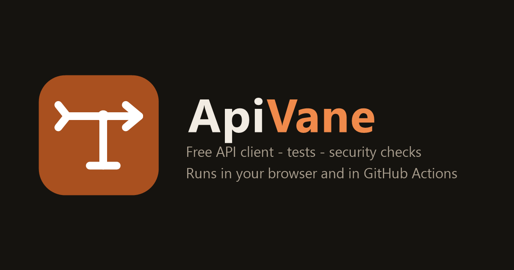

# ApiVane

**A free API client that runs in your browser, checks every response for security issues, and runs the same collection in CI.**
No account, no cloud sync, no seats. Collections are plain YAML in your repo.

**Open the app → https://yousafkhamza.github.io/apivane/**



## What you get

- **Send & inspect** — methods, params, headers, JSON/form/text bodies, auth (Bearer, Basic, API key), pretty JSON, headers, timing, copy as cURL.
- **Tests without code** — status, JSON value, header and response-time checks. Save values from a response (like a login token) and reuse them as `{{variables}}`.
- **Security checks on every response** — missing security headers, risky CORS, secrets or stack traces in responses, unsafe cookies, plain `http://`, secrets in URLs.
- **Your data stays with you** — saved in your browser (autosave, or save yourself with a recovery copy if you forget). Export a backup file to move devices.
- **Import** Postman v2.1 collections and cURL commands.
- **Installable app** on desktop and phone, works offline. Light/dark follows your device.

## Three ways to send requests

Browsers block many cross-site API calls (CORS). Pick what you need — your collection stays the same.

| | Browser only | Extension | Local agent |
|---|---|---|---|
| Install | nothing | Chrome / Edge / Firefox add-on | `npx apivane-cli` or Docker |
| APIs without CORS headers | ✗ | ✓ | ✓ |
| All response headers visible | ✗ | ✓ | ✓ |
| `localhost` / internal APIs | ✗ | ✓ | ✓ |
| Read/write `.apivane/` files in your repo | – | – | ✓ |

### Extension
Download the zip for your browser from the [latest release](https://github.com/yousafkhamza/apivane/releases/latest) (store listings coming), then:
- **Chrome / Edge:** unzip → `chrome://extensions` → Developer mode → *Load unpacked* → pick the folder.
- **Firefox:** `about:debugging#/runtime/this-firefox` → *Load Temporary Add-on* → pick the zip.

Reload the app, then **Connect → Browser extension**.

### Local agent
```bash
npx apivane-cli                 # opens http://127.0.0.1:7878 with a one-time token
# or
docker run --rm -p 127.0.0.1:7878:7878 -v "$PWD:/work" ghcr.io/yousafkhamza/apivane
```
On the website, choose **Connect → Local agent** and paste the token printed in your terminal. **Settings → Save to repo** writes `.apivane/` YAML you can commit.

## Run in CI

```bash
npx apivane-cli run --env staging --reporter cli,junit --out reports
```
Exit code `1` on any failed check or a security finding at or above `--fail-on` (default `high`).

GitHub Actions:
```yaml
- uses: yousafkhamza/apivane@v0.1.0   # use the latest release tag
  with:
    env: staging
    fail-on: high
  env:
    STAGING_TOKEN: ${{ secrets.STAGING_TOKEN }}   # referenced as ${env:STAGING_TOKEN}
```
The action writes a job summary and uploads a JUnit report.

## Collection format

```
.apivane/
  apivane.yaml                 # collection name, shared auth
  environments/staging.yaml    # secrets are ${env:NAME} references, never real values
  requests/users/01-list-users.yaml
```
```yaml
name: Create user
method: POST
url: "{{baseUrl}}/users"
headers:
  Authorization: "Bearer {{token}}"
body:
  type: json
  content: { "name": "Yousaf" }
tests:
  - status: 201
  - jsonpath: "$.id"
    exists: true
  - maxDurationMs: 800
capture:
  userId: "$.id"
```

## Security model

- **Web app:** strict Content-Security-Policy, no third-party scripts, no analytics. Requests go straight from your browser to the API you call. The service worker caches only the app itself — never API responses.
- **Extension:** answers only the ApiVane app (checked by URL), only `ping` and `send` messages, validates every request, and never attaches your browser cookies. It reaches websites only when you press Send.
- **Agent:** binds to `127.0.0.1`, new random token on every start, Host-header check against DNS rebinding, origin allowlist (+ `--allow-origin` for custom domains), Private Network Access preflights only for allowed origins, and file access limited to `.apivane/` (no `..`, YAML only). Docker publishes to `127.0.0.1` only.
- **Secrets:** marked 🔒 values are masked in history, cURL export and reports, left out of backups unless you opt in, and written to repo files only as `${env:NAME}` references.

See [docs/PRIVACY.md](docs/PRIVACY.md).

## How it compares

| | ApiVane | Postman | Insomnia | Bruno |
|---|---|---|---|---|
| Free for teams | ✓ | limited | limited | ✓ |
| Works with no install (web) | ✓ | needs account | ✗ | ✗ |
| Collections as files in git | ✓ | export only | ✓ | ✓ |
| Built-in security checks | ✓ | ✗ | ✗ | ✗ |
| CI runner + GitHub Action | ✓ | ✓ | ✓ | ✓ |

## Development

Zero dependencies — only Node 22+.

```bash
npm run build     # dist/ (Pages site), dist-ext/ (extensions), CLI bundle
npm run check     # static checks: imports, CSP, files, versions
npm test          # unit + agent + runner tests (node:test)
npm run serve     # preview dist/ on http://127.0.0.1:4173
npm run agent     # start the local agent from source
npm run e2e       # browser tests (needs: npm i --no-save @playwright/test@1.49.1)
```

| Folder | What |
|---|---|
| `packages/core` | Pure logic: YAML, variables, tests, security rules, importers, file format |
| `packages/web` | The web app (plain ES modules, no build step) |
| `packages/extension` | MV3 extension, built for Chrome/Edge and Firefox |
| `packages/cli` | `apivane` npm package: agent + CI runner |

### Publishing (maintainers)
1. **GitHub Pages:** Settings → Pages → Source: **GitHub Actions**. Pushing to `main` deploys after tests pass. Custom domain: set repo variable `SITE_URL`.
2. **Releases are automatic.** Every push to `main` that passes tests is checked for [Conventional Commits](https://www.conventionalcommits.org) since the last `v*` tag:

   | Commit | Release |
   |---|---|
   | `fix: …`, `perf: …` | patch `0.1.0 → 0.1.1` |
   | `feat: …` | minor `0.1.1 → 0.2.0` |
   | `feat!: …` or `BREAKING CHANGE:` in the body | major (minor while on 0.x) |
   | `docs:`, `chore:`, `ci:`, `test:` … or `[skip release]` | no release |

   CI then creates the tag and GitHub release (notes + both extension zips), publishes npm (only if the `NPM_TOKEN` repo secret exists) and pushes `ghcr.io/<owner>/apivane:<version>` and `:latest`. The very first release uses the version in `package.json`. Versions are never committed back — the tag is the source of truth. PR titles are checked so squash merges always produce a valid commit.
3. **Stores:** upload `apivane-chrome-X.Y.Z.zip` to the Chrome Web Store (also accepted by Edge Add-ons) and `apivane-firefox-X.Y.Z.zip` to addons.mozilla.org. Privacy policy: `docs/PRIVACY.md`.

## License

MIT © [Yousaf Hamza](https://github.com/yousafkhamza)
